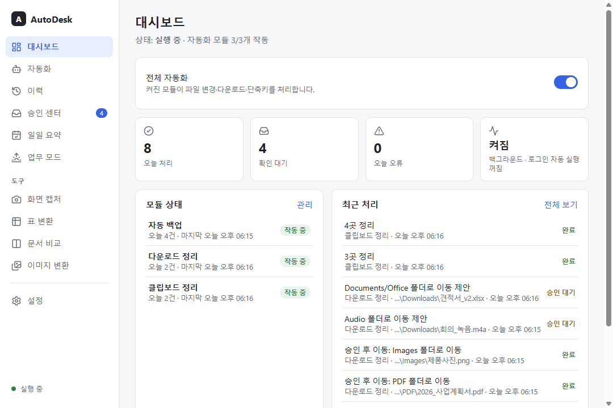
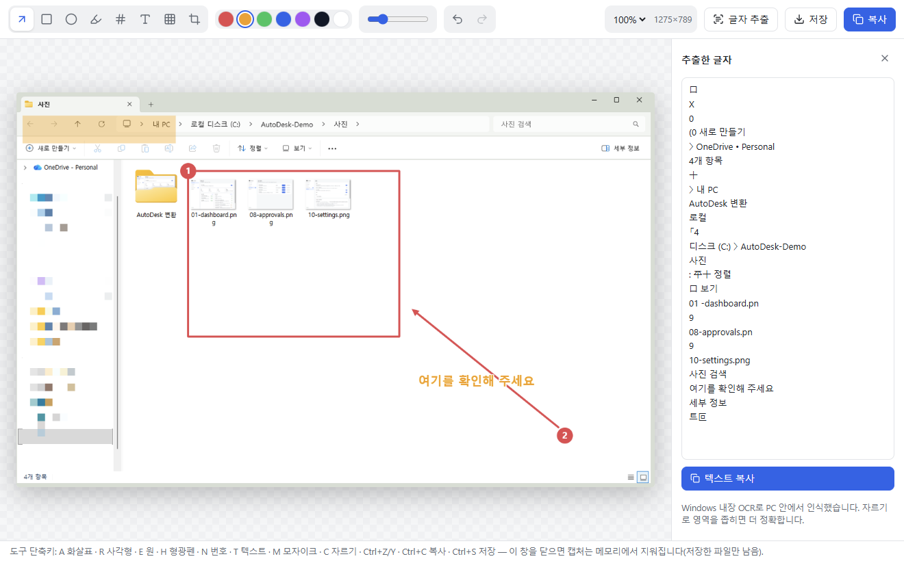
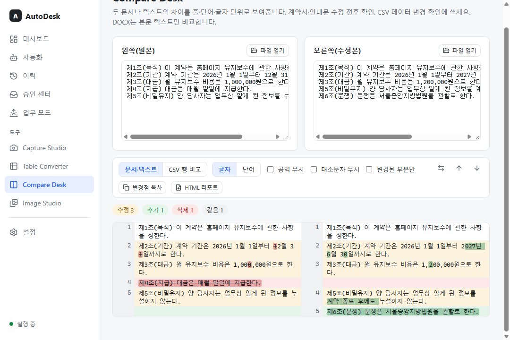
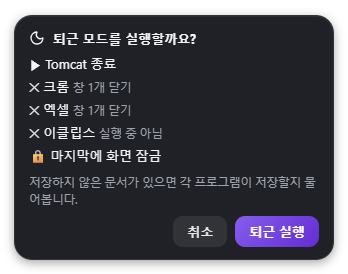

<p align="center"></p>

# AutoDesk

**내 PC에 상주하면서 반복 작업을 조용히 처리하는 개인용 데스크톱 자동화 앱 (Windows · macOS).**

평소처럼 파일을 저장하고, 다운로드하고, 복사하면 AutoDesk가 알아서 처리한다. 안전한 일은 바로 끝내고, 파일을 옮기는 것처럼 확인이 필요한 일은 승인 센터에 올린다. 화면 오른쪽 아래 **업무 모드** 버튼으로 출근·자리 비움·퇴근을 한 번에 하고, 캡처·표 변환·문서 비교·이미지 변환 **도구**도 들어 있다.

> - 완전 무료 · 개인용 · 오프라인 동작 · 텔레메트리 없음
> - 관리자 권한/서비스/데몬 없음 — 프로세스는 `AutoDesk.exe` 하나
> - 전체 · 모듈별 · 백그라운드 상주 · 로그인 자동 실행을 각각 켜고 끔
> - 앱 안의 **완전 제거**로 자동 실행 등록·데이터·설치본까지 정리

## 기능

### 자동화(백그라운드)

| 모듈 | 하는 일 | 안전장치 |
|---|---|---|
| **AutoBackup Guardian** | 등록한 폴더의 파일이 실제로 바뀌면(SHA-256 비교) 이전 버전을 보관. 버전 비교(diff)·복원 | 원본 미수정, 복원은 직접 실행, 덮어쓰기 복원 전 현재 상태 백업, 보관 개수·용량 제한 |
| **Download Butler** | 다운로드 폴더에 새 파일이 오면 PDF/Office/Text/Images/Videos/Audio/Archives/Installers로 분류 | 기본은 미리보기(승인 후 이동), 덮어쓰기·삭제·실행 없음, 모든 이동 되돌리기 가능, 확장자-내용 불일치 시 승인 요청 |
| **AutoPaste** | `Ctrl+Alt+Shift+V`(macOS `⌘⌥⇧V`)를 누르면 클립보드 텍스트의 줄 끝 공백·NBSP·보이지 않는 문자·중복 빈 줄 정리 | 단축키 누를 때만 읽음, 내용 저장 안 함, 코드·URL·이모지 결합 문자 보존 |
| (선택) **Claude Code 다듬기** | `Ctrl+Alt+Shift+B`로 맞춤법·띄어쓰기 교정 | 기본 OFF, 외부 전송 동의 필요, 내 Claude 구독 플랜 사용(추가 요금·API 키 없음) |

### 업무 모드(화면 오른쪽 아래 플로팅 버튼)

| 버튼 | 하는 일 | 안전장치 |
|---|---|---|
| **업무 시작** | 등록한 프로그램·문서·폴더·웹사이트를 순서대로 열고, 꺼져 있던 자동화를 다시 켬 | 등록한 항목만 실행, 웹 주소는 http/https만 |
| **자리 비움** | 화면 잠금(Win+L) 또는 모니터 끄기, 자동화 일시정지(선택) | — |
| **퇴근** | 정리 명령(예: Tomcat `shutdown.bat`) 실행 → 등록한 프로그램에 **정상 종료** 요청 → 화면 잠금/PC 종료(선택) | 실행 전 닫을 항목 확인 창, 저장 안 된 문서는 각 프로그램이 직접 저장 여부를 물음, 강제 종료 기본 OFF, 시스템·탐색기·AutoDesk는 닫지 않음, 창이 남으면 PC 종료 건너뜀 |

### 도구(필요할 때만 실행, 백그라운드에서 돌지 않음)

| 도구 | 하는 일 | 특징 |
|---|---|---|
| **Capture Studio** | 영역·전체·창 캡처(`Ctrl+Alt+Shift+S`) → 화살표·사각형·원·형광펜·번호·텍스트·모자이크·자르기·크기 변경 → 복사·PNG/JPG 저장, **OCR 글자 추출** | 캡처는 메모리에만(저장 전 디스크에 남지 않음), OCR은 Windows 내장 엔진으로 로컬 처리(작은 글씨 자동 2배 확대) |
| **Table Converter** | 엑셀·웹 표·CSV·TSV·JSON·Markdown을 자동 감지해 Markdown·HTML·CSV·엑셀용 CSV(BOM)·TSV·JSON으로 변환, 열/행 선택, 미리보기 | 엑셀/웹에서 복사한 서식 표(병합 셀)까지 해석, 앞자리 0 코드값 보존 |
| **Compare Desk** | 두 문서(TXT·MD·DOCX 등)를 줄·단어·글자 단위로 비교, CSV는 기준 열로 행 매칭, 변경점 복사·HTML 리포트 | 삭제·수정이 섞여도 비슷한 줄끼리 최적으로 짝지음, UTF-8/EUC-KR 자동 |
| **Image Studio** | 여러 이미지를 JPG·PNG·WEBP로 일괄 변환, 맞추기·자르기·비율 리사이즈, **목표 용량(KB) 자동 맞춤**, 전후 용량 비교, 드래그 앤 드롭 | 원본 보존(별도 폴더), 이름 충돌 시 `(2)`, EXIF 회전 반영 |

## 사용 설명서

스크린샷으로 단계별 사용법을 정리한 설명서(36쪽): **[PDF](docs/guide/AutoDesk_사용설명서.pdf)** · **[Word](docs/guide/AutoDesk_사용설명서.docx)**

| 대시보드 | 승인 센터 |
|---|---|
|  |  |
| **Capture Studio 편집기** | **Compare Desk** |
|  |  |
| **업무 모드 버튼** | **퇴근 확인** |
|  |  |

## 설치

1. [Releases](https://github.com/Logic-Phantom/AutoDesk/releases) 또는 [Actions](https://github.com/Logic-Phantom/AutoDesk/actions) 아티팩트에서 설치 파일을 받는다.
   - Windows: `AutoDesk_<버전>_x64-setup.exe` (현재 사용자 설치, 관리자 권한 불필요)
   - macOS: `AutoDesk_<버전>_aarch64.dmg`
2. 서명하지 않은 개인용 빌드라 경고가 뜬다.
   - Windows SmartScreen: **추가 정보 → 실행**
   - macOS: 앱 **우클릭 → 열기** (또는 `xattr -dr com.apple.quarantine /Applications/AutoDesk.app`)

## 사용법

1. **자동화 → AutoBackup**에서 폴더 추가 → 이후 저장할 때마다 버전이 쌓인다. 같은 화면 아래 **버전 기록 · 복원**.
2. **Download Butler**는 켜자마자 미리보기 모드로 동작 → **승인 센터**에서 이동/그대로 두기. 믿을 만하면 자동 이동(AUTO)을 켠다. 되돌리기는 **이력**.
3. 텍스트 복사 → `Ctrl+Alt+Shift+V` → 붙여넣기.
4. **업무 모드**: 왼쪽 메뉴에서 시작할 프로그램·사이트, 퇴근 때 실행할 스크립트·닫을 프로그램을 등록 → 오른쪽 아래 버튼으로 실행.
5. **도구**: `Ctrl+Alt+Shift+S`로 영역 캡처, 표·문서·이미지는 왼쪽 '도구' 메뉴에서.
6. **설정**: 백그라운드 상주(창 닫아도 트레이에 남음), 로그인 시 자동 실행, 알림, 테마, 완전 제거.

트레이 아이콘 메뉴에서 전체 자동화/모듈 ON·OFF, 화면 캡처, 업무 모드 설정, 승인 대기, 프로그램 종료를 바로 할 수 있다.

## 켜고 끄기 · 완전히 끄기 · 제거

| 하고 싶은 것 | 방법 | 결과 |
|---|---|---|
| 잠깐 멈춤 | 트레이 → 전체 자동화 체크 해제 | 모든 감시·단축키 해제, 앱은 떠 있음 |
| 특정 기능만 끔 | 자동화 화면/트레이에서 모듈 체크 해제 | 그 모듈만 해제 |
| 완전히 종료 | 트레이 → 프로그램 종료 (또는 백그라운드 상주 OFF 후 창 닫기) | 프로세스 종료, 아무것도 남지 않음 |
| 부팅 시 안 뜨게 | 설정 → 로그인 시 자동 실행 OFF | OS 등록 해제(실제 상태 재확인) |
| 프로그램 제거 | **설정 → AutoDesk 완전 제거** (권장) | 자동 실행 해제 → 데이터 삭제(백업 보존 선택 가능) → 설치본 제거 → 결과 보고서 |
| Windows 앱 목록에서 제거 | 설정 → 앱 → AutoDesk 제거 | 실행 중 앱 정상 종료, 자동 실행 값 삭제, "앱 데이터 삭제" 체크 시 데이터도 삭제 |

macOS에서 Finder로 휴지통에 버리는 것만으로는 LaunchAgent·데이터가 정리되지 않는다 → 앱 안의 완전 제거를 쓴다. 자세히: [docs/UNINSTALL.md](docs/UNINSTALL.md).

## 무료 · 라이선스 · 정책

- 코드 MIT, 의존성 전부 무료 오픈소스(GPL 없음) — [docs/LICENSES.md](docs/LICENSES.md)
- 유료 API·SaaS·서버 없음. GitHub Actions는 공개 저장소라 무료.
- 코드 서명·자동 업데이트는 비용/서명 키가 필요해 넣지 않음.
- AI: Gemini API 대신 **이미 쓰는 Claude Code CLI**를 선택 기능으로 사용. 짧은 교정 요청은 Pro 플랜 한도로 충분하고, 한도를 넘으면 실패로 끝날 뿐 유료 전환이 없다. 구독 토큰을 다른 프로그램에서 직접 쓰지 않고 공식 CLI만 호출하므로 약관 범위 안이다 — [docs/DECISIONS.md](docs/DECISIONS.md)
- 이름 메모: "Autodesk"는 AutoCAD 회사의 상표다. 개인용이라 문제없지만 공개 배포할 경우 이름 변경 권장.

## 아키텍처

```text
React UI ──invoke──▶ Rust Core (단일 프로세스)
   ▲                  ├─ Lifecycle / Master·Module 스위치 / 트레이
   └── core://changed ├─ 공유 Watch Service(notify) → debounce → jobs(idempotent) → 모듈
                      ├─ AutoBackup · Download Butler · AutoPaste(+Claude CLI)
                      ├─ 업무 모드(workspace): 실행·창 닫기 요청·잠금 ─▶ 플로팅 독 창
                      ├─ 도구(tools): 캡처(xcap)+편집 창·OCR(Windows.Media.Ocr)·이미지(image)·파일 입출력(DOCX)
                      ├─ SQLite(마이그레이션 v3) · JSON 로그
                      └─ Platform: autostart · 설치 위치 · 완전 제거 도우미
```

```text
AutoDesk/
├── src/                     React + TypeScript UI (Dashboard · Automations · Activity · Approvals · Workspace · Settings)
│   ├── pages/tools/         CaptureStudio · TableConverter · CompareDesk · ImageStudio
│   ├── windows/             Dock(플로팅 버튼) · Overlay(영역 선택) · Editor(캡처 편집기)
│   └── lib/                 table · compare(순수 로직 + 테스트) · api
├── src-tauri/
│   ├── src/                 core · db · fsutil · shortcuts · tray · commands · platform · uninstall · ai · workspace
│   │   ├── tools/           capture · ocr · images · files
│   │   └── modules/         backup · downloads · autopaste
│   ├── capabilities/        웹뷰 최소 권한
│   ├── windows/hooks.nsh    NSIS 제거 훅(정상 종료 요청·자동 실행 값 삭제)
│   └── tauri.conf.json
├── docs/                    ARCHITECTURE · DECISIONS · LIFECYCLE_AND_TOGGLES · UNINSTALL · PLATFORM_SUPPORT_MATRIX
│                            SECURITY · TESTING · BUILD_AND_RELEASE · LICENSES · IMPLEMENTATION_STATUS
└── .github/workflows/ci.yml Windows·macOS 빌드/테스트, 태그 시 릴리스
```

상세: [docs/ARCHITECTURE.md](docs/ARCHITECTURE.md)

## 개발

```bash
npm install
npm run tauri:dev
```

```bash
npm run typecheck && npm run lint && npm test && npm run test:rust
```

```bash
npm run tauri:build
```

필요 도구: Node 22+, Rust(stable), Windows는 VS 2022 Build Tools(C++), macOS는 Xcode CLT — [docs/BUILD_AND_RELEASE.md](docs/BUILD_AND_RELEASE.md)

## 작업 내역

### 2026-11-19 — v0.1.0 첫 구현

#### 만든 것

- Tauri 2 + React 19 + Rust 구조, SQLite 마이그레이션, 단일 프로세스 엔진(공유 감시자·debounce·idempotent 작업·시작 시 복구·모듈 오류 격리)
- 전체/모듈/백그라운드/로그인 자동 실행 스위치(실제 OS 등록·감시·단축키와 연동), 트레이 메뉴, 단일 인스턴스, `--autostart`·`--quit`
- AutoBackup Guardian, Download Butler, AutoPaste, 선택 기능 Claude Code 다듬기(기본 OFF)
- 앱 내 완전 제거(Windows PowerShell / macOS bash 일회성 도우미), NSIS 제거 훅
- 화면: 대시보드 · 자동화 · 이력 · 승인 센터 · 설정
- 문서: [아키텍처](docs/ARCHITECTURE.md) · [결정 기록](docs/DECISIONS.md) · [ON/OFF](docs/LIFECYCLE_AND_TOGGLES.md) · [제거](docs/UNINSTALL.md) · [라이선스](docs/LICENSES.md) · [플랫폼](docs/PLATFORM_SUPPORT_MATRIX.md) · [보안](docs/SECURITY.md) · [테스트](docs/TESTING.md) · [빌드](docs/BUILD_AND_RELEASE.md)
- Windows·macOS CI(push마다 테스트·빌드, `v*` 태그 시 릴리스)

#### 원본 기획(Super Prompt) 검토 후 바꾼 점

| 원본 | 적용 | 이유 |
|---|---|---|
| AI: Gemini Provider | **Claude Code CLI**(`claude -p`) 선택 기능 | 쓰고 있는 구독 플랜 안에서 동작(API 키·추가 요금 없음). 짧은 교정은 Pro 플랜으로 충분, 한도 초과 시 실패로 끝나고 유료 전환 없음 |
| Tokio 비동기·동시 작업 2~3개 | 엔진 스레드 1개 순차 처리 | 개인용 처리량에 충분, 같은 파일 경합 없음, 종료가 단순 |
| events·action_runs 테이블 | jobs + activity로 통합 | 중복 저장 제거 |
| Tailwind·Zustand | 일반 CSS 토큰 + React 훅 | 상태는 Rust가 소유, 의존성 최소화 |
| 별도 제거 helper 실행 파일 | 일회성 스크립트(실행 후 자기 삭제) | 추가 바이너리 없이 같은 동작 |
| (없음) | single-instance + `--quit` | 프로세스 중복 방지, 제거 프로그램이 앱을 정상 종료시키는 통로 |
| (없음) | 확장자-내용 시그니처 불일치 감지 | `.pdf`로 위장한 실행 파일은 자동 이동하지 않음 |
| (없음) | 창을 코드로 생성 | `--quit` 실행 시 WebView 캐시가 다시 생기지 않음 |

#### Windows 설치본 실검증 결과

| 항목 | 결과 |
|---|---|
| 전체 자동화 OFF → ON | 실제 OS 감시 2 → 0 → 2개 |
| 모듈 하나(Download Butler) OFF | 감시 2 → 1개, 나머지 모듈 계속 |
| 로그인 시 자동 실행 ON/OFF | `HKCU\…\Run\AutoDesk` 값 생성/삭제(OS 실제 상태 재조회) |
| Download Butler | 다운로드 폴더 PDF → 분류 → 승인 대기(미리보기 모드라 이동 안 함) |
| AutoBackup | 실제 변경 2회 → 스냅샷 2개, 같은 내용 재저장·`~$` 임시 파일 무시, 원본 불변 |
| AutoPaste | 단축키 → 공백·빈 줄 정리, 이력엔 "4곳 정리"만, 로그에 원문 없음 |
| `AutoDesk.exe --quit` | 실행 중 인스턴스 정상 종료, 프로세스 없음 |
| Windows 기본 제거(설정 → 앱) | 실행 중 앱 정상 종료, 자동 실행 값·설치 폴더 삭제(데이터는 "앱 데이터 삭제" 체크 시) |
| **앱 내 완전 제거**(자동 실행 ON 상태) | 프로세스·Run/StartupApproved 값·데이터 2곳·설치 폴더 **잔여 0**, 감시 폴더 원본 보존, 도우미 자기 삭제 |
| 자동 테스트 | Rust 29개 · Vitest 4개 · typecheck · lint 통과 |

#### 검증 중 고친 버그

1. 백업 처리 중 엔진이 DB 잠금을 쥔 채 다시 잠그며 멈추고, 그 상태로 종료하면 앱도 멈춤 → 잠금 범위 수정 + 종료 경로는 `try_lock`으로 막히지 않게 보완
2. 완전 제거 도우미가 앱과 함께 꺼져 아무것도 지워지지 않음 → Job 객체에서 이탈해 실행(`CREATE_BREAKAWAY_FROM_JOB`)

### 2026-11-19 — 사용 설명서 · 화면 개선

- 사용 설명서 PDF/Word(24쪽, 실제 설치본 스크린샷 12장) — 설치, 화면 구성, 켜고 끄기, 기능별 사용법, 승인·되돌리기, AI 다듬기 설정, 완전 제거, FAQ
- 스크린샷 검증 중 발견한 버그 수정: 백업 **비교** 결과가 "NaN KB"로 나오던 문제(Rust↔TS 필드 이름 불일치) + 회귀 테스트 추가(Rust 30개)
- 화면 다듬기: AutoPaste 마지막 실행 시각 기록, 대시보드 빈 항목 구분점, 긴 경로 줄바꿈, 제거 표 열 폭, 소제목 대문자 변환 제거
- 업데이트 설치 검증: 실행 중인 앱 위에 새 설치본을 설치하면 기존 앱이 정상 종료되고 설정·백업은 유지
- CI: Windows·macOS 빌드 모두 성공

### 2026-11-19 — v0.2.0 LogWatcher · Windows QA (LogWatcher는 v0.3.0에서 제거)

- **LogWatcher 모듈 추가**: 로그 파일의 새 줄만 읽기(offset 저장), ERROR/WARN 패턴, 같은 오류 지문으로 묶기(시간·숫자·16진수 무시), 재알림 간격, 스택 트레이스(`at`, `Caused by`)를 문맥으로 보관, 미완성 줄 대기, 로테이션 감지, EUC-KR 로그 해석, Tomcat·JEUS/WebtoB 패턴 묶음
- DB 마이그레이션 v2(`log_offsets`, `log_issues`) — v1 설치본 위에 업데이트 설치 시 기존 데이터 유지 + 이전 DB 자동 백업(`autodesk.v1.bak`) 확인
- Windows 설치본 QA 추가 확인: AUTO 모드 자동 이동, 확장자-내용 불일치 파일 승인 대기, 제외 확장자·다운로드 중 파일 무시, 이름 충돌 `(2)`, 되돌리기·중복 되돌리기 거부, 사본/덮어쓰기 복원, 보관 개수 제한, 모듈 OFF 시 처리 차단, 잘못된 입력 거부, 창 닫기 → 트레이 상주, 백그라운드 OFF 시 창 닫기 = 종료, 두 번째 실행 시 기존 창 표시
- QA 중 고친 것: AUTO 모드에서 되돌린 파일이 다시 옮겨질 수 있던 문제(되돌린 내용은 건너뜀), 분류 경로 구분자 혼용(`Documents/PDF\…`), 반복 오류가 스택 트레이스 문맥을 덮어쓰던 문제
- 설명서 28쪽으로 갱신(LogWatcher 장·FAQ 추가), 테스트 Rust 38개

### 2026-11-20 — v0.3.0 업무 모드 · 도구 4종 (LogWatcher 제거)

- **LogWatcher 제거**(요청): 코드·화면·설명서에서 삭제. 기존 설치본은 업데이트 시 DB 마이그레이션 v3가 남은 테이블·등록·이력을 자동 정리
- **업무 모드 + 플로팅 버튼**: 화면 오른쪽 아래 투명 독(접힘 → 펼침 → 퇴근 확인/결과로 크기 자동 조절, 작업 표시줄 위 여백 고정). 업무 시작(프로그램·문서·폴더·URL 순서대로), 자리 비움(잠금/모니터 끄기), 퇴근(정리 스크립트 → 정상 종료 요청 → 잠금/PC 종료 예약·취소)
- **Capture Studio**: 영역(전체 화면 오버레이 드래그)·전체·창 캡처, 편집기(화살표·사각형·원·형광펜·번호·텍스트·모자이크·자르기·크기·실행 취소 50단계), 클립보드 이미지 복사, PNG/JPG 저장, Windows 내장 OCR(로컬, 작은 글씨 2배 확대), 전역 단축키 `Ctrl+Alt+Shift+S`, 트레이 메뉴
- **Table Converter / Compare Desk / Image Studio** 추가(위 기능 표 참고)
- 원본 기획 검토 후 반영: 퇴근 시 강제 저장 대신 '정상 종료 요청'(프로그램이 직접 저장 여부 질문, 강제 종료 기본 OFF), 캡처는 디스크 임시 파일 없이 메모리만, OCR은 별도 엔진 설치 없이 Windows 내장 엔진, WebP는 무손실만 지원하므로 용량 목적이면 JPG 안내
- 디버그 빌드 캐시가 14GB까지 커져 디스크가 가득 찬 문제 → 개발 프로필 디버그 정보 축소(약 1.9GB)

#### v0.3.0 Windows 설치본 실검증

| 항목 | 결과 |
|---|---|
| 플로팅 독 | 투명 창으로 오른쪽 아래 표시, 접힘/펼침/퇴근 확인 크기 자동 조절 |
| 업무 시작 | 메모장 실행 + 폴더 열기, 꺼진 자동화 다시 켜기 |
| 자리 비움 | 자동화 일시정지(잠금은 실사용 방해로 생략, 코드 경로는 `LockWorkStation`) |
| 퇴근 | 정리 스크립트 실행 → 메모장 정상 종료(Windows 11 메모장은 저장 안 된 탭을 세션에 보관해 내용 유지 확인) |
| 입력 검증 | `explorer.exe` 닫기 등록 거부, `file://` 주소 거부 |
| 캡처 | 전체 1920×1080, 영역 드래그 400×300, 창 캡처, 클립보드 이미지 복사, PNG/JPG 저장, 편집기 닫으면 메모리 캡처 삭제 |
| 편집기 | 빠른 드래그에서도 도형 3개 모두 기록(실행 취소 3단계), 편집기 재사용 시 새 캡처로 초기화 |
| OCR | 한국어 UI 텍스트 인식(2배 확대 후 정확도 향상 확인) |
| Image Studio | 원본 보존, 60KB 제한 맞춤(품질 81), WebP·커버 리사이즈, 없는 파일 오류 표시 |
| 파일 | DOCX 본문 추출, 허용 안 된 확장자 저장 거부 |
| 업데이트 설치 | 실행 중 v0.2 → v0.3 덮어 설치 시 정상 종료 후 교체 |
| 완전 제거 | 독·편집기 포함 프로세스·데이터·자동 실행·설치본 잔여 0 |
| 자동 테스트 | Rust 44개 · Vitest 21개 · typecheck · lint 통과 |

#### v0.3.0 QA 중 고친 버그

1. 보안 정책(CSP)이 `blob:` 이미지를 막아 편집기·선택 창이 캡처를 표시하지 못함
2. 새 편집기를 열 때 이전 편집기를 닫으며 방금 찍은 캡처까지 지움 → 편집기 재사용 + 캡처 세대 번호로 보호
3. Windows에서 동기 명령 안에서 창을 만들면 앱이 멈춤(영역 선택 후 편집기 빈 화면) → 창을 만드는 명령을 모두 비동기로
4. 빠르게 드래그하면 마지막 도형·선택 영역이 빠짐 → 상태를 reducer/ref로 원자적으로 기록
5. 플로팅 독 오른쪽이 잘리고 그림자가 창 경계에서 잘려 회색 사각형으로 보임
6. 문서 비교에서 삭제·수정이 섞이면 엉뚱한 줄끼리 '수정'으로 짝지음 → 유사도 기반 최적 정렬(테스트 추가)
7. Image Studio 용량 증가 시 "-84% 증가"로 표시, 드롭다운이 카드 밖으로 넘침, 창 목록 앱 이름이 전체 경로로 표시

#### 아직 확인하지 않은 것

- 재부팅 후 실제 자동 시작(레지스트리 등록까지만 확인)
- 자리 비움의 실제 화면 잠금·모니터 끄기, 퇴근 후 PC 종료 예약(사용 중인 PC라 실행하지 않음)
- 여러 모니터·고배율(125%·150%) 환경의 영역 캡처 좌표
- Claude Code 다듬기(이 PC에서 `claude` CLI를 찾지 못함)
- macOS 전체(`NOT_VERIFIED_ON_MACOS`) — 코드·CI 빌드만 준비, macOS OCR 미지원

#### 다음 작업

1. 여러 모니터·고배율 환경에서 영역 캡처 확인
2. macOS 실기기 QA(집 Mac), macOS OCR(Vision) 연동
3. 후속 모듈(Daily Work Digest 또는 Document Guard)

상세: [docs/IMPLEMENTATION_STATUS.md](docs/IMPLEMENTATION_STATUS.md)

## 로드맵(미구현 — UI에 노출하지 않음)

Document Guard(문서 맞춤법·용어 검사) · ProjectGuard(저장 시 검사) · Daily Work Digest(일일 처리 요약)
