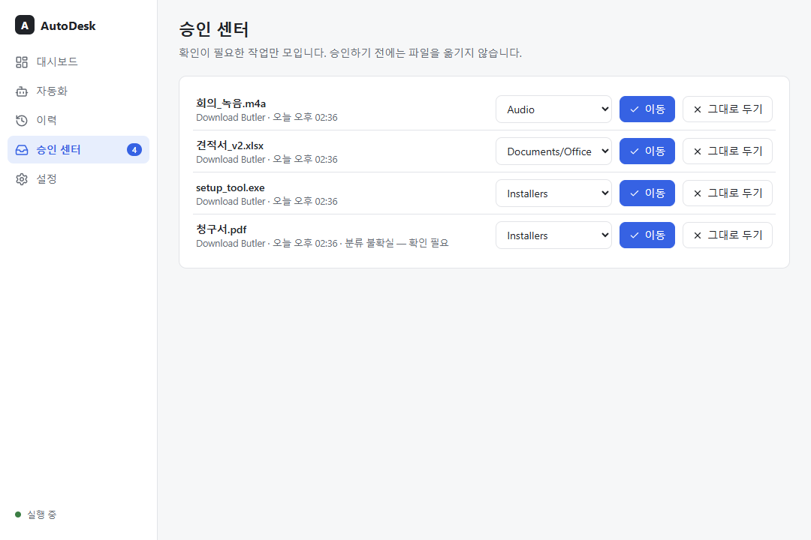
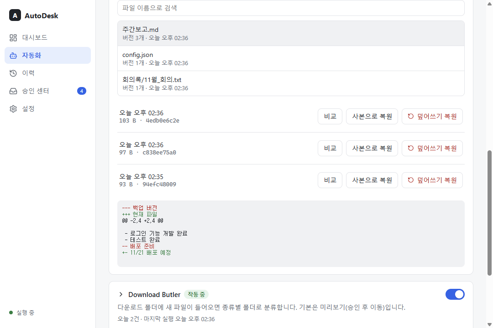
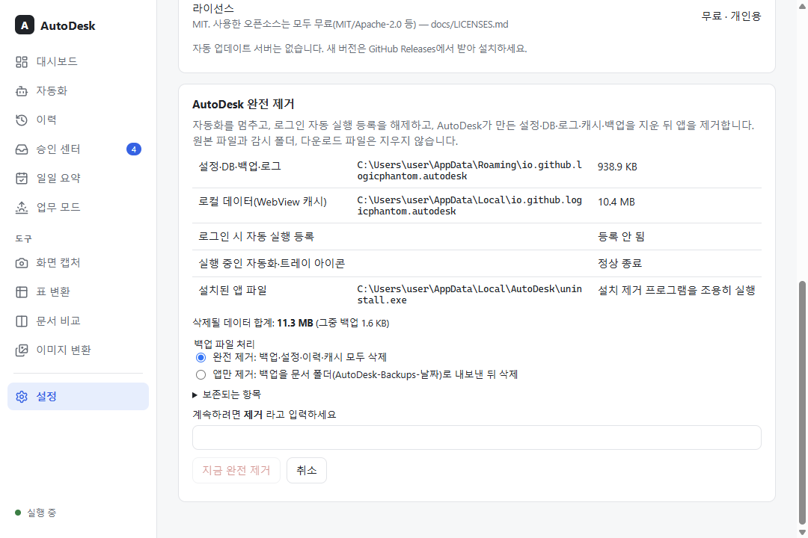

<p align="center"></p>

# AutoDesk

**내 PC에 상주하면서 반복 작업을 조용히 처리하는 개인용 데스크톱 자동화 앱 (Windows · macOS).**

평소처럼 파일을 저장하고, 다운로드하고, 복사하면 AutoDesk가 알아서 처리한다. 안전한 일은 바로 끝내고, 파일을 옮기는 것처럼 확인이 필요한 일은 승인 센터에 올린다.

> - 완전 무료 · 개인용 · 오프라인 동작 · 텔레메트리 없음
> - 관리자 권한/서비스/데몬 없음 — 프로세스는 `AutoDesk.exe` 하나
> - 전체 · 모듈별 · 백그라운드 상주 · 로그인 자동 실행을 각각 켜고 끔
> - 앱 안의 **완전 제거**로 자동 실행 등록·데이터·설치본까지 정리

## 기능 (MVP)

| 모듈 | 하는 일 | 안전장치 |
|---|---|---|
| **AutoBackup Guardian** | 등록한 폴더의 파일이 실제로 바뀌면(SHA-256 비교) 이전 버전을 보관. 버전 비교(diff)·복원 | 원본 미수정, 복원은 직접 실행, 덮어쓰기 복원 전 현재 상태 백업, 보관 개수·용량 제한 |
| **Download Butler** | 다운로드 폴더에 새 파일이 오면 PDF/Office/Text/Images/Videos/Audio/Archives/Installers로 분류 | 기본은 미리보기(승인 후 이동), 덮어쓰기·삭제·실행 없음, 모든 이동 되돌리기 가능, 확장자-내용 불일치 시 승인 요청 |
| **AutoPaste** | `Ctrl+Alt+Shift+V`(macOS `⌘⌥⇧V`)를 누르면 클립보드 텍스트의 줄 끝 공백·NBSP·보이지 않는 문자·중복 빈 줄 정리 | 단축키 누를 때만 읽음, 내용 저장 안 함, 코드·URL·이모지 결합 문자 보존 |
| **LogWatcher** | 선택한 로그 파일에 새로 쌓이는 줄에서 ERROR·Exception·SEVERE를 감지해 알림. Tomcat·JEUS/WebtoB 패턴 묶음 | 같은 오류는 묶어서 횟수만 집계·재알림 간격, 스택 트레이스 보관, 로테이션·EUC-KR 대응, 로그는 외부 전송 없음 |
| (선택) **Claude Code 다듬기** | `Ctrl+Alt+Shift+B`로 맞춤법·띄어쓰기 교정 | 기본 OFF, 외부 전송 동의 필요, 내 Claude 구독 플랜 사용(추가 요금·API 키 없음) |

## 사용 설명서

스크린샷으로 단계별 사용법을 정리한 설명서(28쪽): **[PDF](docs/guide/AutoDesk_사용설명서.pdf)** · **[Word](docs/guide/AutoDesk_사용설명서.docx)**

| 대시보드 | 승인 센터 |
|---|---|
|  |  |
| **버전 기록·복원** | **완전 제거** |
|  |  |

## 설치

1. [Releases](https://github.com/Logic-Phantom/AutoDesk/releases) 또는 [Actions](https://github.com/Logic-Phantom/AutoDesk/actions) 아티팩트에서 설치 파일을 받는다.
   - Windows: `AutoDesk_<버전>_x64-setup.exe` (현재 사용자 설치, 관리자 권한 불필요)
   - macOS: `AutoDesk_<버전>_aarch64.dmg`
2. 서명하지 않은 개인용 빌드라 경고가 뜬다.
   - Windows SmartScreen: **추가 정보 → 실행**
   - macOS: 앱 **우클릭 → 열기** (또는 `xattr -dr com.apple.quarantine /Applications/AutoDesk.app`)

## 사용법

1. **자동화 → AutoBackup**에서 폴더 추가 → 이후 저장할 때마다 버전이 쌓인다. 같은 화면 아래 **버전 기록 · 복원**.
2. **Download Butler**는 켜자마자 미리보기 모드로 동작 → **승인 센터**에서 이동/그대로 두기. 믿을 만하면 자동 이동(AUTO)을 켠다. 되돌리기는 **이력**.
3. 텍스트 복사 → `Ctrl+Alt+Shift+V` → 붙여넣기.
4. **설정**: 백그라운드 상주(창 닫아도 트레이에 남음), 로그인 시 자동 실행, 알림, 테마, 완전 제거.

트레이 아이콘 메뉴에서 전체 자동화/모듈 ON·OFF, 승인 대기, 프로그램 종료를 바로 할 수 있다.

## 켜고 끄기 · 완전히 끄기 · 제거

| 하고 싶은 것 | 방법 | 결과 |
|---|---|---|
| 잠깐 멈춤 | 트레이 → 전체 자동화 체크 해제 | 모든 감시·단축키 해제, 앱은 떠 있음 |
| 특정 기능만 끔 | 자동화 화면/트레이에서 모듈 체크 해제 | 그 모듈만 해제 |
| 완전히 종료 | 트레이 → 프로그램 종료 (또는 백그라운드 상주 OFF 후 창 닫기) | 프로세스 종료, 아무것도 남지 않음 |
| 부팅 시 안 뜨게 | 설정 → 로그인 시 자동 실행 OFF | OS 등록 해제(실제 상태 재확인) |
| 프로그램 제거 | **설정 → AutoDesk 완전 제거** (권장) | 자동 실행 해제 → 데이터 삭제(백업 보존 선택 가능) → 설치본 제거 → 결과 보고서 |
| Windows 앱 목록에서 제거 | 설정 → 앱 → AutoDesk 제거 | 실행 중 앱 정상 종료, 자동 실행 값 삭제, "앱 데이터 삭제" 체크 시 데이터도 삭제 |

macOS에서 Finder로 휴지통에 버리는 것만으로는 LaunchAgent·데이터가 정리되지 않는다 → 앱 안의 완전 제거를 쓴다. 자세히: [docs/UNINSTALL.md](docs/UNINSTALL.md).

## 무료 · 라이선스 · 정책

- 코드 MIT, 의존성 전부 무료 오픈소스(GPL 없음) — [docs/LICENSES.md](docs/LICENSES.md)
- 유료 API·SaaS·서버 없음. GitHub Actions는 공개 저장소라 무료.
- 코드 서명·자동 업데이트는 비용/서명 키가 필요해 넣지 않음.
- AI: Gemini API 대신 **이미 쓰는 Claude Code CLI**를 선택 기능으로 사용. 짧은 교정 요청은 Pro 플랜 한도로 충분하고, 한도를 넘으면 실패로 끝날 뿐 유료 전환이 없다. 구독 토큰을 다른 프로그램에서 직접 쓰지 않고 공식 CLI만 호출하므로 약관 범위 안이다 — [docs/DECISIONS.md](docs/DECISIONS.md)
- 이름 메모: "Autodesk"는 AutoCAD 회사의 상표다. 개인용이라 문제없지만 공개 배포할 경우 이름 변경 권장.

## 아키텍처

```text
React UI ──invoke──▶ Rust Core (단일 프로세스)
   ▲                  ├─ Lifecycle / Master·Module 스위치 / 트레이
   └── core://changed ├─ 공유 Watch Service(notify) → debounce → jobs(idempotent) → 모듈
                      ├─ AutoBackup · Download Butler · AutoPaste(+Claude CLI)
                      ├─ SQLite(마이그레이션) · JSON 로그
                      └─ Platform: autostart · 설치 위치 · 완전 제거 도우미
```

```text
AutoDesk/
├── src/                     React + TypeScript UI (Dashboard · Automations · Activity · Approvals · Settings)
├── src-tauri/
│   ├── src/                 core · db · fsutil · shortcuts · tray · commands · platform · uninstall · ai
│   │   └── modules/         backup · downloads · autopaste
│   ├── capabilities/        웹뷰 최소 권한
│   ├── windows/hooks.nsh    NSIS 제거 훅(정상 종료 요청·자동 실행 값 삭제)
│   └── tauri.conf.json
├── docs/                    ARCHITECTURE · DECISIONS · LIFECYCLE_AND_TOGGLES · UNINSTALL · PLATFORM_SUPPORT_MATRIX
│                            SECURITY · TESTING · BUILD_AND_RELEASE · LICENSES · IMPLEMENTATION_STATUS
└── .github/workflows/ci.yml Windows·macOS 빌드/테스트, 태그 시 릴리스
```

상세: [docs/ARCHITECTURE.md](docs/ARCHITECTURE.md)

## 개발

```bash
npm install
npm run tauri:dev
```

```bash
npm run typecheck && npm run lint && npm test && npm run test:rust
```

```bash
npm run tauri:build
```

필요 도구: Node 22+, Rust(stable), Windows는 VS 2022 Build Tools(C++), macOS는 Xcode CLT — [docs/BUILD_AND_RELEASE.md](docs/BUILD_AND_RELEASE.md)

## 작업 내역

### 2026-11-19 — v0.1.0 첫 구현

#### 만든 것

- Tauri 2 + React 19 + Rust 구조, SQLite 마이그레이션, 단일 프로세스 엔진(공유 감시자·debounce·idempotent 작업·시작 시 복구·모듈 오류 격리)
- 전체/모듈/백그라운드/로그인 자동 실행 스위치(실제 OS 등록·감시·단축키와 연동), 트레이 메뉴, 단일 인스턴스, `--autostart`·`--quit`
- AutoBackup Guardian, Download Butler, AutoPaste, 선택 기능 Claude Code 다듬기(기본 OFF)
- 앱 내 완전 제거(Windows PowerShell / macOS bash 일회성 도우미), NSIS 제거 훅
- 화면: 대시보드 · 자동화 · 이력 · 승인 센터 · 설정
- 문서: [아키텍처](docs/ARCHITECTURE.md) · [결정 기록](docs/DECISIONS.md) · [ON/OFF](docs/LIFECYCLE_AND_TOGGLES.md) · [제거](docs/UNINSTALL.md) · [라이선스](docs/LICENSES.md) · [플랫폼](docs/PLATFORM_SUPPORT_MATRIX.md) · [보안](docs/SECURITY.md) · [테스트](docs/TESTING.md) · [빌드](docs/BUILD_AND_RELEASE.md)
- Windows·macOS CI(push마다 테스트·빌드, `v*` 태그 시 릴리스)

#### 원본 기획(Super Prompt) 검토 후 바꾼 점

| 원본 | 적용 | 이유 |
|---|---|---|
| AI: Gemini Provider | **Claude Code CLI**(`claude -p`) 선택 기능 | 쓰고 있는 구독 플랜 안에서 동작(API 키·추가 요금 없음). 짧은 교정은 Pro 플랜으로 충분, 한도 초과 시 실패로 끝나고 유료 전환 없음 |
| Tokio 비동기·동시 작업 2~3개 | 엔진 스레드 1개 순차 처리 | 개인용 처리량에 충분, 같은 파일 경합 없음, 종료가 단순 |
| events·action_runs 테이블 | jobs + activity로 통합 | 중복 저장 제거 |
| Tailwind·Zustand | 일반 CSS 토큰 + React 훅 | 상태는 Rust가 소유, 의존성 최소화 |
| 별도 제거 helper 실행 파일 | 일회성 스크립트(실행 후 자기 삭제) | 추가 바이너리 없이 같은 동작 |
| (없음) | single-instance + `--quit` | 프로세스 중복 방지, 제거 프로그램이 앱을 정상 종료시키는 통로 |
| (없음) | 확장자-내용 시그니처 불일치 감지 | `.pdf`로 위장한 실행 파일은 자동 이동하지 않음 |
| (없음) | 창을 코드로 생성 | `--quit` 실행 시 WebView 캐시가 다시 생기지 않음 |

#### Windows 설치본 실검증 결과

| 항목 | 결과 |
|---|---|
| 전체 자동화 OFF → ON | 실제 OS 감시 2 → 0 → 2개 |
| 모듈 하나(Download Butler) OFF | 감시 2 → 1개, 나머지 모듈 계속 |
| 로그인 시 자동 실행 ON/OFF | `HKCU\…\Run\AutoDesk` 값 생성/삭제(OS 실제 상태 재조회) |
| Download Butler | 다운로드 폴더 PDF → 분류 → 승인 대기(미리보기 모드라 이동 안 함) |
| AutoBackup | 실제 변경 2회 → 스냅샷 2개, 같은 내용 재저장·`~$` 임시 파일 무시, 원본 불변 |
| AutoPaste | 단축키 → 공백·빈 줄 정리, 이력엔 "4곳 정리"만, 로그에 원문 없음 |
| `AutoDesk.exe --quit` | 실행 중 인스턴스 정상 종료, 프로세스 없음 |
| Windows 기본 제거(설정 → 앱) | 실행 중 앱 정상 종료, 자동 실행 값·설치 폴더 삭제(데이터는 "앱 데이터 삭제" 체크 시) |
| **앱 내 완전 제거**(자동 실행 ON 상태) | 프로세스·Run/StartupApproved 값·데이터 2곳·설치 폴더 **잔여 0**, 감시 폴더 원본 보존, 도우미 자기 삭제 |
| 자동 테스트 | Rust 29개 · Vitest 4개 · typecheck · lint 통과 |

#### 검증 중 고친 버그

1. 백업 처리 중 엔진이 DB 잠금을 쥔 채 다시 잠그며 멈추고, 그 상태로 종료하면 앱도 멈춤 → 잠금 범위 수정 + 종료 경로는 `try_lock`으로 막히지 않게 보완
2. 완전 제거 도우미가 앱과 함께 꺼져 아무것도 지워지지 않음 → Job 객체에서 이탈해 실행(`CREATE_BREAKAWAY_FROM_JOB`)

### 2026-11-19 — 사용 설명서 · 화면 개선

- 사용 설명서 PDF/Word(24쪽, 실제 설치본 스크린샷 12장) — 설치, 화면 구성, 켜고 끄기, 기능별 사용법, 승인·되돌리기, AI 다듬기 설정, 완전 제거, FAQ
- 스크린샷 검증 중 발견한 버그 수정: 백업 **비교** 결과가 "NaN KB"로 나오던 문제(Rust↔TS 필드 이름 불일치) + 회귀 테스트 추가(Rust 30개)
- 화면 다듬기: AutoPaste 마지막 실행 시각 기록, 대시보드 빈 항목 구분점, 긴 경로 줄바꿈, 제거 표 열 폭, 소제목 대문자 변환 제거
- 업데이트 설치 검증: 실행 중인 앱 위에 새 설치본을 설치하면 기존 앱이 정상 종료되고 설정·백업은 유지
- CI: Windows·macOS 빌드 모두 성공

### 2026-11-19 — v0.2.0 LogWatcher · Windows QA

- **LogWatcher 모듈 추가**: 로그 파일의 새 줄만 읽기(offset 저장), ERROR/WARN 패턴, 같은 오류 지문으로 묶기(시간·숫자·16진수 무시), 재알림 간격, 스택 트레이스(`at`, `Caused by`)를 문맥으로 보관, 미완성 줄 대기, 로테이션 감지, EUC-KR 로그 해석, Tomcat·JEUS/WebtoB 패턴 묶음
- DB 마이그레이션 v2(`log_offsets`, `log_issues`) — v1 설치본 위에 업데이트 설치 시 기존 데이터 유지 + 이전 DB 자동 백업(`autodesk.v1.bak`) 확인
- Windows 설치본 QA 추가 확인: AUTO 모드 자동 이동, 확장자-내용 불일치 파일 승인 대기, 제외 확장자·다운로드 중 파일 무시, 이름 충돌 `(2)`, 되돌리기·중복 되돌리기 거부, 사본/덮어쓰기 복원, 보관 개수 제한, 모듈 OFF 시 처리 차단, 잘못된 입력 거부, 창 닫기 → 트레이 상주, 백그라운드 OFF 시 창 닫기 = 종료, 두 번째 실행 시 기존 창 표시
- QA 중 고친 것: AUTO 모드에서 되돌린 파일이 다시 옮겨질 수 있던 문제(되돌린 내용은 건너뜀), 분류 경로 구분자 혼용(`Documents/PDF\…`), 반복 오류가 스택 트레이스 문맥을 덮어쓰던 문제
- 설명서 28쪽으로 갱신(LogWatcher 장·FAQ 추가), 테스트 Rust 38개

#### 아직 확인하지 않은 것

- 재부팅 후 실제 자동 시작(레지스트리 등록까지만 확인)
- 트레이 메뉴 클릭(메뉴 동작 코드는 화면 스위치와 같은 명령 사용)
- Claude Code 다듬기(이 PC에서 `claude` CLI를 찾지 못함 — 설치·로그인 후 확인 필요)
- macOS 전체(`NOT_VERIFIED_ON_MACOS`) — 코드·CI 빌드만 준비

#### 다음 작업

1. macOS 실기기 QA(집 Mac)
2. Claude Code CLI 설치 후 AI 다듬기 실사용 확인
3. 후속 모듈(Daily Work Digest 또는 Document Guard)

상세: [docs/IMPLEMENTATION_STATUS.md](docs/IMPLEMENTATION_STATUS.md)

## 로드맵(미구현 — UI에 노출하지 않음)

Document Guard(문서 맞춤법·용어 검사) · ProjectGuard(저장 시 검사) · Daily Work Digest(일일 처리 요약)
